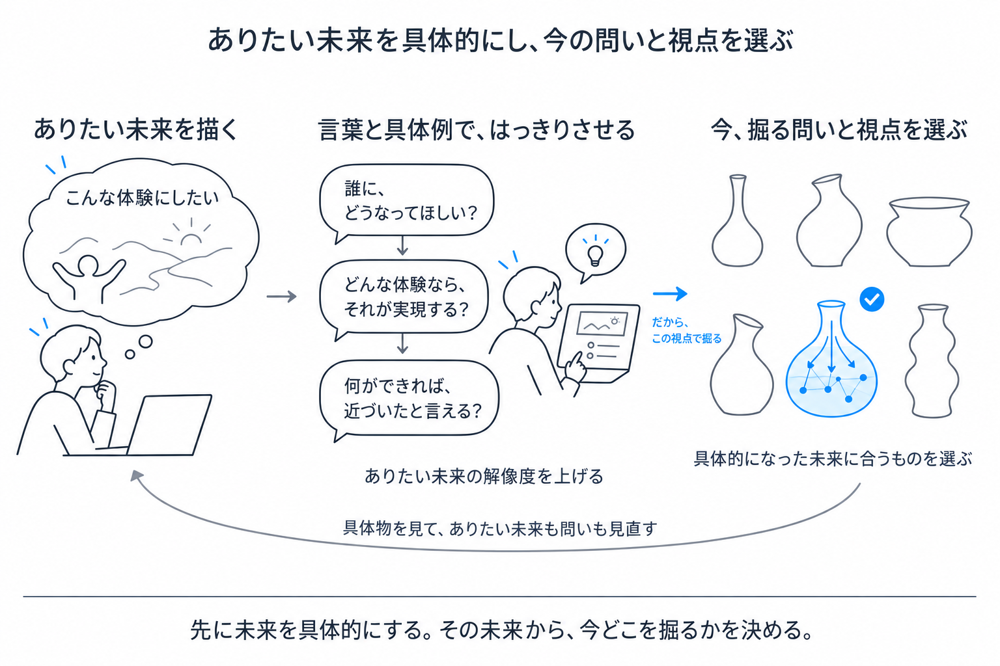
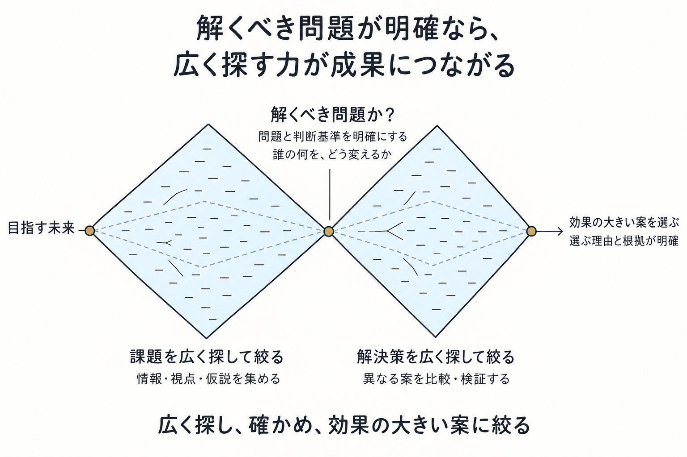
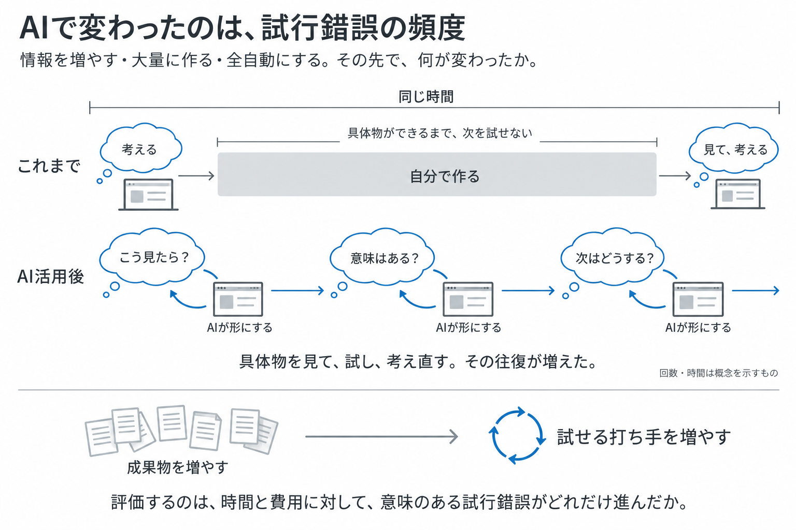
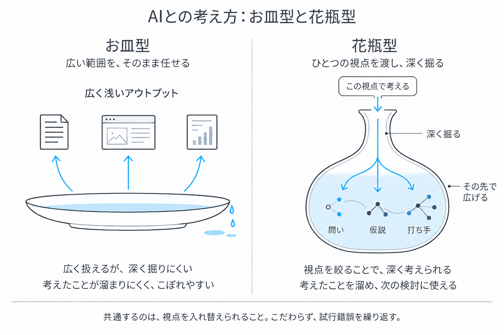
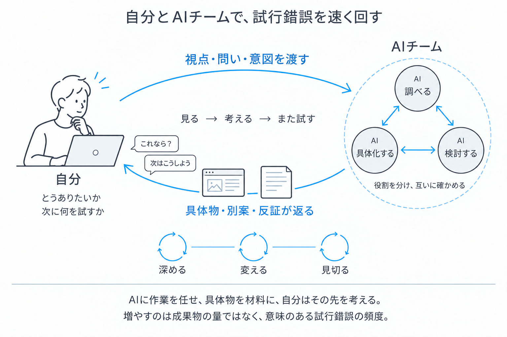

# PdMの思想と判断基準

2026年10月25日時点

顧客理解からビジョン、戦略、実行、検証までをつなぎ、判断の基準を整理する。

## 1．商い主義

顧客への価値提供と、事業として続けられることを一緒に考える。

- 顧客に価値を届け、対価を得て、継続して選ばれる状態を作る
- 一社への提供で終わらず、他の顧客にも広げ、利益が残る形にする
- 職種の担当範囲に閉じず、サービス、売り方、提供体制をつなげて考える
- 判断と働きかけが、顧客の成果や事業の結果にどうつながったかを見る

目指す状態を明らかにし、そこへ進むための判断と行動を担う。

## 2．全体像

### 活動の循環

| 要素 | 主な問い | 他の要素との関係 |
| --- | --- | --- |
| ビジョン | 顧客にどんな可能性を渡し、どんな世界を実現するか | Big Pictureを描き、戦略の方向を定める |
| 顧客理解 | 誰が、何を達成したくて、何に困っているか | ビジョン・戦略を具体化し、前提を確かめる |
| 戦略 | どの顧客・市場で、何を変え、なぜそこに賭けるか | 課題選択と投資判断の基準になる |
| 課題選択・資源配分 | どの問題が解決に値し、今どこまで投資するか | 問題を引き受ける範囲と優先順位を定める |
| 仮説検証 | 何が不確かで、何を確かめれば判断が変わるか | 課題・解決策・事業成立の仮説を確かめる |
| 実行 | 選んだ方針を、誰が、どこまでやり切るか | モーションとアウトプットで、選んだ方針を実行に移す |
| 結果からの更新 | 期待した変化と実際の結果に、どんな差があるか | 手段・課題選択・戦略の前提へ戻して更新する |

ビジョン、顧客理解、戦略、課題選択・資源配分、仮説検証、実行、結果からの更新を、相互に行き来しながら進める。顧客から得た事実によって戦略へ戻ることも、実行中に仮説や問題の定義を見直すこともある。視座・視野・時間軸を広げ、目の前の課題だけに判断を閉じない。

### 意思決定

意思決定は、すべての活動と、その間を行き来する過程に常に存在する。どんな世界を目指すか、顧客の状況をどう捉えるか、何に集中するか、何を検証するか、どう実行するか、結果を受けて何を変えるかを、その都度判断する。

成果を高めるには、その前提となる判断の範囲と質を高める必要がある。ビジョンから日々の実行まで、あらゆる場面で判断の質を点検する。

そのため、意思決定を全体に共通する観点として点検する。何を判断対象にしたか、どんな選択肢と根拠があるか、思い込みに偏っていないか、どの条件で判断を更新するかを確かめる。

参考：[プロダクトマネージャーの良い意思決定についてQuestする](https://speakerdeck.com/sonehara/pmconf2024-purodakutomaneziyanoliang-iyi-si-jue-ding-nituitequestsuru-2f3db2b2-56e0-44d7-82aa-10af2520554d)／[Decision Qualityの6要素](https://sdg.com/decision-quality/)／[The 6 Principles of Decision Quality](https://smartorg.com/improve-quality-decision-making/)

## 3．顧客理解と提供価値

顧客理解では、発言や要望に加えて、実際の行動と、その背景にある制約を把握する。

確認事項

- 達成したいことと、期待する成果
- 現在の手順、判断、例外処理、回避策
- すでに負担している時間・費用・人員
- 利用者、買い手、管理者、周辺関係者の違い
- 一人・一社に固有の事情と、他にも共通する事情

提供価値は、次の二つの観点で捉える。

| 観点 | 意味 |
| --- | --- |
| 段取りの最適性 | 目的に合った進め方になっているか |
| 利得の実効性 | 期待した成果・変化を実際に得られるか |

手間の削減だけで価値を判断しない。目的によっては、残すべき手間もある。

顧客理解の成果は、接触回数や収集量に加え、仮説・優先順位・作るものがどう変わったかで確認する。

### 価値への感性

人が何に心を動かされ、何に夢中になるかを観察する。サービスを自ら使い、体験への理解を深める。その実感を出発点としつつ、顧客の反応や行動によって理解を更新する。

## 4．提供範囲と負担

提供価値を考える際には、次の両方を見る。

- 顧客が何をできるようになるか
- 顧客が何を抱え続けなくて済むようになるか

対象は機能だけでなく、導入、運用、保守、例外対応、環境変化への対応も含む。どこまで引き受けるかは、顧客価値と自社の持続性を踏まえて決める。

同時に、次を確認する。

- ベンダーが負担を吸収したか
- 顧客企業内の別の人へ負担を移しただけではないか
- 新たな判断や作業を増やしていないか
- 行動が繰り返された結果、問題を悪化させないか

具体例

| 事例 | 得られる価値 | 併せて確認すること |
| --- | --- | --- |
| マイページ | 管理側が従業員との共通接点を持てる | 従業員が入口の使い分けに迷わないか |
| 採用スカウトの効率化 | 採用側の送信負担が減る | 候補者の負担や反応低下を通じ、双方の成果を損なわないか |
| コンテンツ投稿の容易化 | 発信への参加者が増える | 受け手の価値と、良いコンテンツの継続供給につながるか |

個別の指標が上がっても、顧客の成果や事業全体の価値が下がる場合がある。これを「最適化の罠」として捉える。選んだ課題の中で改善を進めるときも、指標と目標自体を見直す。

### 成果と周囲への影響

プロダクトの成果は、人の行動や成果がどう変わったかによって確かめる。これをアウトカムとして捉える。ただし、行動が変わったことと価値が生まれたことは同じではない。他の人の負担、商慣習、組織の仕事、長期的な結果まで見る。数字が改善したときも、全体の価値を損なっていないかを問い直す。

## 5．ビジョンと戦略

### 目指す世界

ビジョンは、顧客にどんな可能性を渡し、どんな世界を実現したいかを示す。ドメインと顧客事情を広く深く知った上で、現在の困り事を直す範囲を超えて、顧客が何をできるようになるかを考える。その世界で誰がどう働き、何が変わるかという全体像を、Big Pictureとして描く。戦略は、その未来へ進むための選択として組み立てる。

ビジョンと戦略を考える際にも、第2節の意思決定の原則を適用する。機能の改善だけを判断対象にせず、どんな世界を目指し、どの顧客にどんな変化を届けるかから考え、取り組むべき課題と期待する成果を定める。

参考：[Vision vs. Strategy](https://www.svpg.com/vision-vs-strategy/)

### 問いと課題解決

問いを立てて目指す世界を描き、実現するための戦略を選び、課題解決の構造を使って顧客に届ける価値を具体化する。

プロダクトビジョンは、「誰の世界を、なぜ、どのような状態へ変えたいのか」を問いながら組み立てる。次の五つの問いを、顧客とニーズ、顧客理解、指標、ロードマップにつなげて考える。

| **問い** | **対応するもの** | **明らかにすること** |
| --- | --- | --- |
| Who：誰の世界を変えたいか | 顧客 | 誰に向き合うのか |
| Why：なぜ変える必要があるか | ニーズ | その人にとって、なぜ変化が必要なのか |
| What：現在の世界と制約はどうなっているか | 顧客理解 | どんな状況で、何に制約されているのか |
| When：実現したと、どうわかるか | 指標 | どんな変化が起きれば、目指す状態に届いたと言えるか |
| How：どう変化を起こすか | ロードマップ | どんな手段と順序で進めるか |

問いへの答えをつなぐことで、目指す世界の姿が具体的になる。顧客の現状や制約を踏まえ、誰に集中するか、何から変えるか、どこに力を使うかを選ぶと戦略になる。その選択を、具体的な取り組みと順序として示すとロードマップになる。

戦略に沿ってバリュープロポジションを考える際には、顧客の現状とありたい姿を捉え、その差から取り組む問題と解決策を具体化する。

| **課題解決の構造** | **考えること** |
| --- | --- |
| 現状（As Is） | その顧客は、今どんな状態にいるか |
| ありたい姿（To Be） | ビジョンが実現した世界で、その顧客はどうなれるか |
| 差（Gap） | 現状とありたい姿の間に、どんな隔たりがあるか |
| 取り組む問題（Problem） | その差のうち、何を解決することが重要か |
| 解決策（Solution） | このプロダクトで、どう解決するか |

この構造から、「誰の、どんな問題を、どう解決し、どんな価値を届けるのか」をまとめる。人物の属性だけでなく、場面、行動、できるようになること、本人にとってのうれしさまで含めて、バリュープロポジションとして描く。

プロダクトビジョンは目指す世界を示し、戦略はそこへ向かうための選択を定め、バリュープロポジションは対象顧客に届ける具体的な価値を示す。顧客から得た事実に応じて、現状やありたい姿、戦略の前提も見直す。

参考：[プロダクトビジョンの講演動画](https://youtu.be/mQyoLlDiuTA)／[バリュープロポジション](https://www.strategyzer.com/value-proposition)

### 世界観とキャラクター

プロダクトビジョンで目指す世界観を描き、バリュープロポジションで、その中のキャラクターと行動・体験を描く。どんな人が何をし、何ができるようになり、何がうれしいかまでを一続きで捉える。企画には両方が必要だと考える。

| **要素** | **考えること** | **比喩で捉えると** |
| --- | --- | --- |
| プロダクトビジョン | どんな世界を目指し、そこで人はどんな体験をしているか | 世界観を描く |
| ミッション | その実現に向け、自分たちは何を担うか | 世界を実現する側の役割を定める |
| バリュープロポジション | どんな人が、どの場面で何をし、何ができるようになり、何がうれしいか | キャラクターと、その行動・体験を描く |

世界観を目指して、どんなキャラクターが何をするのかを明らかにする。人物の属性だけで終わらせず、状況、行動、できるようになること、本人にとってのうれしさまでを、バリュープロポジションとして一緒に描く。

両者の違いは、時間軸だけではなく、捉える範囲と視点にある。プロダクトビジョンも具体的に描けるし、まだ存在しない製品についてバリュープロポジションを考えることもできる。

一つのビジョンから、顧客ごとに複数のバリュープロポジションが生まれる。たとえば、働く機会を広げるという世界観でも、求職者には自分に合う仕事を探せること、採用担当者には必要な人材に出会えることが、具体的な価値になる。

企画では、世界観を描き、そこに登場する人を定め、その人が何をするのかを具体化する。そこで生まれる良い変化が、顧客にとって選ぶ理由になるかを確かめる。世界観とキャラクターの行動・体験を行き来しながら、戦略や作るものを判断する。

参考：[Vision to Execution](https://www.linkedin.com/pulse/vision-execution-why-what-how-behind-linkedins-products-tomer-cohen-34l4f)

### 課題選択と資源配分

戦略では、以下を明確にする。

- 対象とする顧客・市場と、選ばれる価値・根拠
- ビジョンへの進み方と、引き受ける不確実性
- 優先すること・見送ること
- 仮説を見直す条件

ロードマップは、この判断を具体的な取り組みや順序へ反映したものとして扱う。

事業戦略は、次の三つを接続して考える。

- サービス戦略：何を、どこまで提供するか
- 市場の獲得・拡大戦略：どう届け、顧客を増やすか
- 組織戦略：どの体制・能力で実現するか

優先順位を伝える際は、順位や配分率に加えて、背景と判断条件を共有する。

- なぜ今重要なのか
- どんな成果を、いつまでに期待するのか
- どの前提に基づいているか
- どこまで取り組むか
- 何が分かったら、増やす・変える・止めるか

資源配分は仮説として扱い、結果から更新する。探索では、重要な不確実性が減ったことも投資判断の材料になる。すでに費やした時間ではなく、これから得られる価値と必要な投資を比べ、継続・変更・中止を決める。

参考：『イシューからはじめよ』

### 判断の偏り

思い込みによって判断が偏ることを、バイアスとして点検する。課題への固着、改善の局所最適化、既存の見立てを正当化する行動を分け、問い直す対象を選ぶ。

| 判断の場面 | 陥り方と影響 | 問い直すこと |
| --- | --- | --- |
| ビジョン・戦略 | 流行や周囲の賛成に従うバンドワゴン効果。方向を考えずに開発を急ぎ、判断の範囲を狭める。 | 目指す世界に合っているか。より広いBig Pictureから、他の選択肢も比べたか。 |
| 課題選択 | 取り組む問題を実際以上に重要だと感じる固着バイアス。重要ではない課題に投資し続ける。 | 何をもって重要としたか。解決による変化の大きさを見積もるインパクトサイジングで、他の課題と比べ直したか。 |
| 仮説検証・結果の解釈 | 自分で作ったものを高く評価する偏り。愛着などから都合のよい数字や声を選び、既存の見立てを正当化すると、判断を更新できない。 | 反対の証拠と別の解釈を検討したか。過去の努力を理由にしていないか。今から選んでも、この案に投資するか。 |
| 改善・評価 | 一部の指標だけを改善し、全体の価値を損なう最適化の罠。課題選択が妥当でも起こる。 | その数字は顧客の成果を示すか。第4節の観点で、他の人への負担と長期の影響まで確かめたか。 |
| 意思決定・実行・資源配分 | 今まで起きなかった問題を軽く見る正常性バイアス。品質や安全性への投資を後回しにする。 | 失敗するとしたらなぜか。例外や大きな損失に備え、必要な投資と確認を仕組みにしたか。 |

参考：[意思決定で陥りがちなバイアスと対処法](https://speakerdeck.com/sonehara/pmconf2024-purodakutomaneziyanoliang-iyi-si-jue-ding-nituitequestsuru-2f3db2b2-56e0-44d7-82aa-10af2520554d)

### 他部門への影響

ロードマップを組み替えると、開発だけでなく営業やマーケティングの予定にも影響する。必要な変更は行いつつ、他部門の負担や事業全体への影響を引き受け、理由を共有する。組織戦略では、採用時の見極めと、採用後の育成・役割・配置を区別する。「Hire slow, fire fast」は組織判断を曖昧にしないための示唆として扱い、人事上の即断を正当化するものとはしない。

## 6．行動と成果物

モーションは、目的と状況に応じて選ぶ具体的な働きかけ。

振り返りでは、以下を分ける。

| 観点 | 確認すること |
| --- | --- |
| 状況判断 | 何が起きていると捉えたか |
| 目的との接続 | なぜ、そこへ働きかける必要があると判断したか |
| 選択 | 他の選択肢と比較して、なぜその動きを選んだか |
| 実行 | 必要な変化が起きるところまで実行できたか |
| 結果 | 何が変わり、次は何を修正するか |

会議も目的に応じて設計する。情報収集なら必要な情報を引き出し、決定なら結論・経緯・計画を伝える。目的によって振る舞いと評価基準を変える。

アウトプット主義と行動主義は、次のようにつながる。

- 節目ごとに、その時点の目的を果たす成果物を作りきる
- 相手が理解・判断できる形で渡す
- その成果物で何を判断し、その後どう動くかまで考える

### 手法の選択

フレームワークやプロセスは、それに従うことを目的にしない。ユーザーストーリーマッピングを書くこと自体がユーザー理解ではなく、理解した結果を整理して伝えるために形式を使う。ビジネスモデルキャンバスは、自分の構想の抜けや矛盾を点検し、別の視点を得るために役立つ。手法は、目的に応じて選ぶ。

### 判断基準の共有

何を価値と捉え、なぜそう判断したのかを、他の人が判断に使える形で共有する。途中の作業をすべて見せる必要はないが、他の人の判断に影響する前提や変更理由は伝える。

参考：[意思決定の役割分担](https://www.bain.com/insights/rapid-decision-making/)

## 7．事業検証

| 段階 | 確かめること |
| --- | --- |
| 作れる | 実際の利用条件で、必要な体験・仕組みが成立するか |
| 売れる | 顧客が価値を認めて支払い、利用による成果が出るか |
| 拡販できる | 他の顧客にも、共通する価値・売り方・提供方法が成立するか |
| 稼げる | 獲得・開発・導入・運用の費用を踏まえて利益が残るか |

検証の要点

- 売れる → 拡販できる：購入理由と提供方法の共通性
- 拡販できる → 稼げる：顧客増加に伴う費用と利益の変化

一社への個別対応から学び、共通部分、設定で吸収できる差分、個別開発を区別する。

次の仮説を、この検証に接続する。

| 仮説 | 問い |
| --- | --- |
| ニーズ | 誰が、どんな場面で、何を達成したいか |
| 課題 | どこで詰まり、何が負担になっているか |
| 価値 | 提案によって行動や成果が改善するか |
| 収益 | 誰が、何に、いくら払うか |
| 成長 | どう新しい顧客を獲得し、提供を広げるか |

### 検証と更新

仮説検証では、課題の重要性、解決策の価値、実現性、収益性を分けて確かめる。検証前に、期待する変化、判断に必要な証拠、継続・変更・中止の条件、次に確かめる時点を定める。

仮説検証・実行・更新の判断でも、判断の対象、期待する成果、実行可能な選択肢、根拠となる情報、別の解釈、実行する体制を確かめる。

意思決定では、選ぶ案と見送る案、その理由、担当と実行範囲を明確にする。何が起きたら判断を変えるかも共有し、結果を確かめるところまでやり切る。

顧客が使わないときは、機能追加に進む前に、導入障壁と課題の重要性を行動・データから確かめる。課題が重要なら手段を変え、重要性が低ければ問題の定義・課題選択へ戻る。対象顧客や期待する変化が違えば戦略を見直し、目指す世界の具体像に疑問が出た場合は、その前提まで戻る。

振り返りでは、期待と結果の差、外れた前提、次に変える判断を残す。結果の良し悪しと、当時の情報に照らした判断の妥当性を分け、次の意思決定へ反映する。

ビジョン・戦略を前提に、現状理解、ジョブの整理、課題選択、体験設計・検証、要件化をつなげ、その背景と判断をPRDにまとめる。

参考：[意思決定の質と実行](https://speakerdeck.com/sonehara/pmconf2024-purodakutomaneziyanoliang-iyi-si-jue-ding-nituitequestsuru-2f3db2b2-56e0-44d7-82aa-10af2520554d)／[判断を記録して振り返る](https://fs.blog/decision-journal/)

## 8．構造化と習熟

判断材料を整理し、他の人に伝えるために、次の四つの方法を使う。

| 方法 | 用途 |
| --- | --- |
| 点を集める | 判断材料を蓄える |
| 対比を作る | 差、前提、別の解釈を明らかにする |
| レーンをもつ | 全体と個別などを並行して進め、相互に更新する |
| 一つに束ねる | コンセプト・言葉・画面として、理解と判断を可能にする |

構造化する範囲を、個別の課題から事業全体へ広げる。

| 観点 | 具体的な方向 |
| --- | --- |
| 視座を高める | 個別の改善を、事業の目的・戦略・市場構造へ接続する |
| 視野を広げる | 利用者・買い手・管理者・周辺関係者の影響を捉える |
| 時間軸を延ばす | 利用が反復・拡大した先の変化を見る |
| ドメイン理解を深める | 業界固有の利害、制約、例外、反作用を把握する |
| モーションの質を揃える | 選択と実行を分けて振り返り、使える動きを増やす |

### 挑戦と習熟

経験を積み、目的と判断基準が明確になった仕事は、結果を確かめられる範囲でAIに任せる。そこで生まれた時間と注意を、未知の領域での試行錯誤に向ける。ここでは、未知の領域をL、習熟した領域をN/Oとして捉える。

Lで試行錯誤し、結果を確かめ、判断基準を身につける。経験を重ねた部分は、やがてN/Oへ移り得る。そのうちAIに目的や判断基準を渡し、結果を確かめられる部分を委譲する。そこで生まれた時間と注意を、次のLに向ける。

「Lへの挑戦 → 経験・検証による習熟 → N/Oへの移行 → 任せられる部分の委譲 → 次のLへの挑戦」という循環によって、取り組める領域を広げる。何を考え続け、何を習熟・委譲できる領域へ移すかを見直す。

### 直感と熟考

素早く自動的に判断する働きをSystem 1、注意を向けて意識的に考える働きをSystem 2と呼ぶ。この区別は思考の働きを捉えるもので、LとN/Oは自分が経験してきた領域を捉えるもの。両者は同じ区分ではない。

共通するのは、以前は意識して考える必要があったことも、経験を重ねると少ない負担で扱えるようになり、その分の注意を新たな問いに向けられるという点。ただし、N/Oでも複雑な判断や前提の変化にはSystem 2が必要になり、Lでも既存の経験から生まれる直感を出発点にできる。System 1＝N/O、System 2＝Lとは対応させない。

自分の中で素早く判断できるようになることと、AIに仕事を任せることも分ける。前者は自分の考え方の変化であり、後者は仕事の分担を変えること。経験から素早く気づける力を育てつつ、その直感を検証する姿勢を持つ。条件が変わった場面では、慣れた領域でも前提から考え直す。

参考：[Maps of Bounded Rationality](https://www.nobelprize.org/uploads/2018/06/kahnemann-lecture.pdf)

### AIとの協働

AIには探索、分析、反証、表現を任せられる。経験を積んだN/Oでは、目的や判断基準を渡し、出てきたものの良し悪しを判断しやすいため、委譲を進められる。ただし、慣れた領域のすべてを一律に任せるのではなく、結果を確かめられる範囲を見極める。どんな体験に心を動かされ、どの価値を選び取るかという判断は、自分自身が引き受ける。

「お皿型から花瓶型へ」は、AIに任せる際の考えの深め方を表す。広く任せるだけでなく、自分の視点を明確にして渡し、深く考え、文脈を蓄積し、その先で広げる。仮説が変われば、蓄積した考えも更新する。

この方法は、N/Oで得た判断基準をAIに渡すことにも、Lで問いを定めて考えを深めることにも使う。花瓶型はAIと考えを深める方法を、L→N/Oの循環は経験と分担の更新を示す。両者を組み合わせ、AIに任せて生まれた余地を、新しい領域での試行錯誤に使う。

チームでは、背景と判断を相手が使える形で渡し、異なる専門や実装から得た発見を、自分の判断へ戻す。

顧客の具体的な行動から、事業・市場・長期的な影響までをつなぎ、判断できる範囲を広げる。

